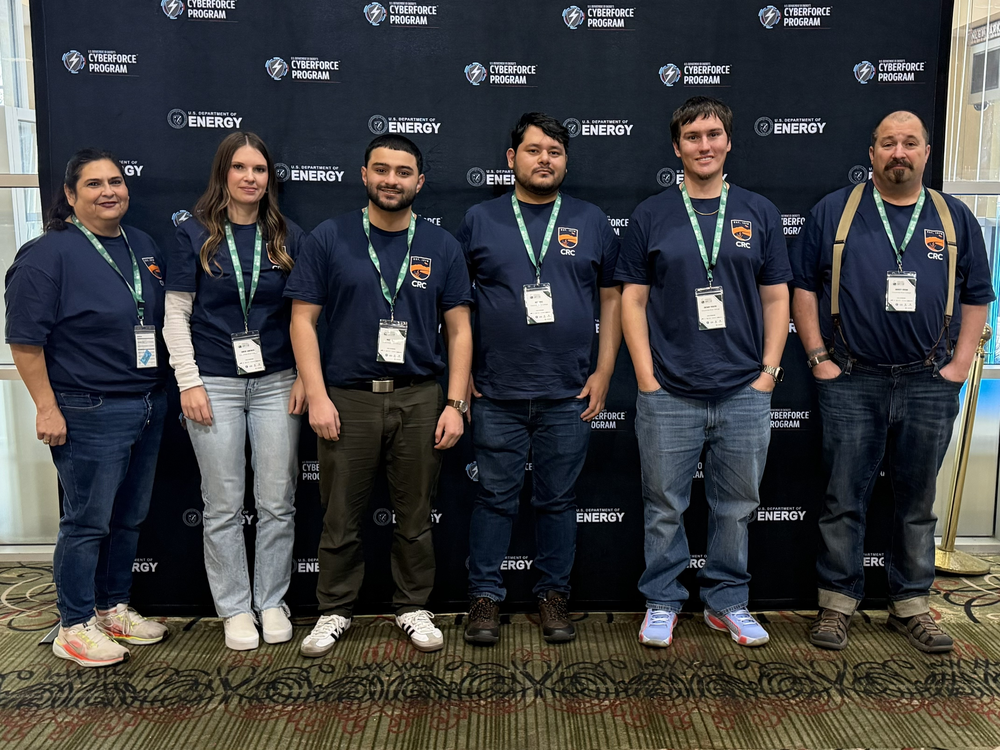

# Competition Gallery

Highlights from our Blue Team defenses, CTF nights, and collegiate cyber competitions.

## DOE CyberForce Competition 2026 – Chicago, IL

Department of Energy (DOE) CyberForce Competition 2026 — Chicago, IL — CRC CyberHawks representing Cosumnes River College at the national Department of Energy competition, defending critical infrastructure and securing services.
